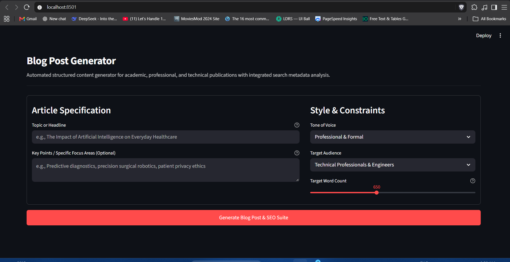

# Blog Post Generator & Search Metadata Suite

A structured, AI-powered long-form blog generation application equipped with integrated search engine optimization (SEO) analysis, readability metrics, and multi-channel distribution tools.

---

## Problem Statement

**Problem Statement 4:**  
*Students struggle to start writing blogs. Generate a structured blog post (title, intro, sections, conclusion) from a topic and tone chosen by the user.*

Writing cohesive, well-organized articles from scratch often leads to writer's block and fragmented structuring. This project provides an automated solution that takes a user-specified topic, writing tone, target audience, and word count, and generates a publication-ready blog post (with an engaging introduction hook, logically sectioned H2 headings, bullet points, and an actionable conclusion) alongside an automated SEO metadata suite.

---

## Screenshots

### Application Interface


---

## Features

- **Structured Content Generation:** Produces articles adhering strictly to the H1 title, introductory context hook, 3–4 sectioned H2 body blocks, and conclusion hierarchy.
- **Adaptive Tone & Audience Controls:** Tailor output style (Professional, Informative, Analytical, Conversational, Executive) for specific audiences.
- **Integrated SEO Suite:** Automatically generates search engine snippet previews (SERP), optimized meta titles, 140–160 character meta descriptions, and focus keyword tags.
- **Readability & Content Analytics:** Computes live word counts, estimated reading time, structural compliance scores, and readability levels.
- **Multi-Format Export:** Instant one-click downloads in GitHub-flavored Markdown (`.md`) and plain text (`.txt`).
- **Secure Backend Authentication:** API credentials are automatically loaded via environment variables (`.env`), keeping sensitive keys isolated from UI and source control.

---

## How to Run

### 1. Clone the Repository
```bash
git clone https://github.com/<your-username>/<your-repo-name>.git
cd <your-repo-name>
```

### 2. Configure Your API Key
Create a `.env` file in the root directory (refer to `.env.example`):
```env
GEMINI_API_KEY="your_google_gemini_api_key_here"
```

### 3. Install Dependencies
```bash
pip install -r requirements.txt
```

### 4. Run the Application
```bash
streamlit run app.py
```
The application will launch automatically in your default browser at `http://localhost:8501`.

---

## Project Structure

```text
├── app.py              # Main Streamlit application & LLM orchestration
├── requirements.txt    # Python package dependencies
├── .env.example        # Environment variable template
├── .gitignore          # Git exclusion rules (protects .env and caches)
├── README.md           # Project documentation and setup guide
├── report.md           # 2-Page assignment procedure report
└── media/
    └── image.png       # UI screenshots for documentation
```
